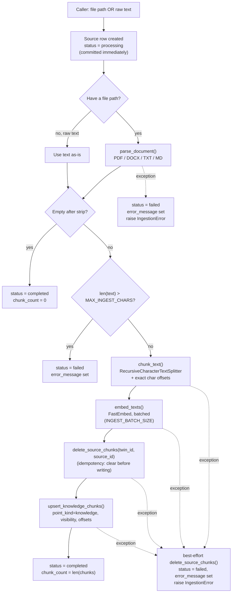

# Ingestion pipeline — flow

> Covers `backend/ingestion/parser.py`, `backend/ingestion/pipeline.py`, and the
> `process_document`/`embed_texts` functions in `backend/rag/embeddings.py` they
> call into. For the wider project (schema, Qdrant tenancy, real-time call plans),
> see [`../../CLAUDE.md`](../../CLAUDE.md).

## What this owns

This is the **only** place in the codebase allowed to write a knowledge chunk into
Qdrant. Everything upstream (a future FastAPI upload endpoint, a manual-note form,
an owner answering an escalated [`KnowledgeGap`](../db/models.py)) ends by calling
`IngestionPipeline.ingest_file()` or `.ingest_text()`. Nothing else should call
`upsert_knowledge_chunks` directly.

## The flow

## Step by step

1. **Create the `Source` row first, as `processing`, and commit immediately.**
   This happens before any parsing/chunking/embedding, so the row exists — with an
   id other code can reference — even if everything after it fails. It's also
   what a future "stuck in processing" reconciliation job would scan for.
2. **Parse** (file path) or use the **raw text** directly (manual notes,
   escalation answers, and eventually ASR transcripts all arrive as text — by the
   time it's text, the pipeline doesn't care where it came from).
3. **Guard rails before any expensive work**: empty text short-circuits to a
   completed, zero-chunk source (not an error — an empty upload isn't a failure).
   Oversized text (`> MAX_INGEST_CHARS`, default 500,000 chars) is rejected
   *before* chunking or embedding even start.
4. **Chunk with exact offsets.** `RecursiveCharacterTextSplitter(..., add_start_index=True).create_documents(...)`
   — the splitter computes each chunk's `start_index` itself while walking the
   text, so `char_start`/`char_end` in the Qdrant payload are exact, not a
   best-effort re-search for where the chunk came from.
5. **Embed in batches** (`INGEST_BATCH_SIZE`, default 64) — flat memory use
   regardless of document size. No GPU here (CPU-only hardware, see
   [`CLAUDE.md` §9.2](../../CLAUDE.md)), so this matters more than it would with one.
6. **Delete-then-insert, always.** `delete_source_chunks(twin_id, source_id)` runs
   unconditionally before the new points are written. This is the whole
   idempotency guarantee: retrying a failed attempt, or re-processing the same
   `source_id` for any reason, can never leave duplicate or stale chunks behind.
7. **Upsert, then mark completed.** The `Source` row only becomes `completed`
   after the Qdrant write succeeds — `chunk_count` is set from what was actually
   written, not assumed.
8. **On any failure between steps 4–7**: best-effort delete whatever this attempt
   may have already written (so a failed ingestion never leaves half-indexed
   chunks silently poisoning retrieval), mark the `Source` `failed` with the error
   message, and raise `IngestionError` so the caller knows definitively.

## Why no two-phase commit

Postgres and Qdrant are two separate systems with no shared transaction. Rather than
attempt distributed-transaction machinery (real complexity for an FYP-scale system),
correctness comes from **ordering**: never mark something `completed` until the
Qdrant write it depends on has actually succeeded, and always clean up Qdrant state
on failure rather than leaving it ambiguous. The one accepted gap: if the Qdrant
write succeeds but the final Postgres commit somehow fails, you'd have orphaned
Qdrant points with no `completed` Source row pointing at them — rare, and the fix
(a periodic job that reconciles sources stuck in `processing`) is a Phase 6/polish
item, not needed now.

## Embedding model and chunking strategy — and why

**Model: FastEmbed running `BAAI/bge-small-en-v1.5` (384 dimensions), not
sentence-transformers, not a larger BGE variant, not a paid API.**

- **FastEmbed over sentence-transformers**: FastEmbed runs ONNX Runtime quantized
  models, which is meaningfully faster CPU inference than the PyTorch-based
  `sentence-transformers` library for the same model. There is no GPU anywhere in
  this project (confirmed hardware constraint, see `CLAUDE.md` §9.2) — every single
  chunk embedded and every single query embedded runs on CPU, so this isn't a minor
  optimization, it's the difference between ingestion being fast and ingestion
  being the bottleneck.
- **`bge-small` over `bge-base`/`bge-large`**: smaller model, smaller 384-dim
  vectors, faster CPU inference, lower memory, *and* cheaper Qdrant operations —
  cosine similarity over 384 dimensions is less work than over 768 or 1024, which
  matters because Qdrant is running embedded, on the same CPU, as everything else
  (and will eventually share that CPU with the real-time ASR/TTS loop from §9.2).
  "Small" doesn't mean low-quality here specifically: BGE models are trained with
  contrastive learning *for retrieval*, not as general-purpose sentence embeddings,
  so `bge-small` punches above its parameter count for exactly this job.
  `DEFAULT_VECTOR_SIZE = 384` in `backend/vectordb/collections.py` and
  `EMBEDDING_DIM = 384` in `Settings` are already aligned with this choice.
- **Not a paid embedding API (e.g. OpenAI)**: same "free and self-hosted" principle
  decided for the whole real-time stack in `CLAUDE.md` §9.1 — no reason to make an
  exception for embeddings specifically.
- **English-only, for now**: appropriate for the current content; a multilingual
  upgrade path exists (`bge-m3`) if that's ever needed, at the cost of a larger,
  slower model.
- **512-token max sequence length, vs. 500-character chunks (~100-125 tokens
  English)**: comfortable headroom — chunks never approach the model's input
  limit, so nothing is ever silently truncated. This was a real constraint checked,
  not assumed.

**Chunking: `RecursiveCharacterTextSplitter`, 500 characters, 50-character (10%)
overlap.**

- **Recursive, not naive fixed-width**: the splitter tries separators in priority
  order — paragraph breaks, then line breaks, then spaces, raw characters only as
  a last resort — so it prefers breaking at natural structural boundaries and only
  cuts mid-sentence when a single paragraph is too long to avoid it. This is
  standard, well-regarded practice, not a shortcut.
- **500 characters**: a deliberate sweet spot for short-form personal/professional
  content (bios, notes, Q&A-style material) — large enough to carry a coherent
  idea (a paragraph, a few sentences), small enough that one chunk's embedding
  stays specific to one topic rather than averaging several together, which hurts
  retrieval precision. Long-form documents (research papers, legal text) often
  warrant larger chunks (1000–1500 chars); that's a documented tuning knob
  (`CHUNK_SIZE` in `Settings`), not a fixed assumption.
- **10% overlap**: prevents the case where a sentence or idea is split exactly at
  a chunk boundary and neither resulting chunk fully captures it. 10–20% is the
  commonly cited range in RAG practice; 10% was chosen as the lower-cost end
  (overlap means re-embedding duplicated text, which isn't free on CPU).

## Known limitations, not fixed here

- **No markdown-heading-aware chunking.** A chunk doesn't carry which `## Heading`
  it fell under. The old (deleted) pre-migration chunker tracked this; it would be
  a reasonable addition later, deliberately deferred to keep this build focused.
- **No GitHub/LinkedIn fetchers.** `Source.source_type` already has `github` and
  `linkedin` values, and `ingest_text()` is the entry point anything that *fetches*
  external text would feed into — but nothing fetches yet. Same for ASR
  transcripts once the real-time call pipeline (§9) exists.
- **Synchronous, not backgrounded.** `IngestionPipeline` is a plain callable class
  with no assumption about its calling context — deliberately, since there's no
  FastAPI layer yet to decide whether it should run inline or on a task queue. That
  decision belongs to Phase 3, not here.
- **Reconciliation job for orphaned Qdrant points** (the one accepted gap above)
  isn't built — Phase 6 territory.
